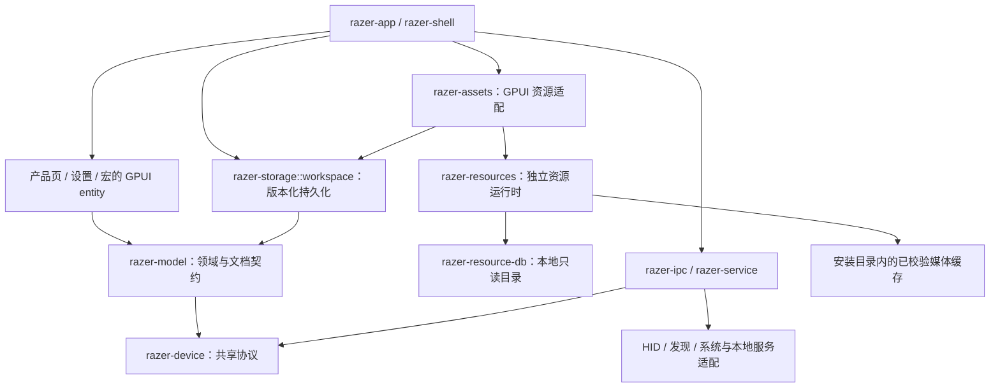

# 架构与证据身份

本项目按完整工作区管理代码、生成工具、资源和安装生命周期。功能依据逆向取得并核验的当前 Razer 原始 JS／CSS、资源及本地二进制调用链；架构参考不提供 Razer 协议或界面行为依据。目录调整、编译通过和数据等价不代表全部原版功能已经实现。

## 职责和依赖方向

| 所有者 | 责任与边界 |
| --- | --- |
| 根程序、`razer-app` | 进程入口、应用初始化和各功能组合；入口不复制页面、协议或资源实现 |
| `razer-shell` | 窗口、导航和 UI／后台动作接线；按页面及连接保留任务、订阅、焦点和清理所有权 |
| `razer-pages`、`razer-app-pages` | 设备页和应用页的交互、状态与来源呈现；render 只读取状态、组合界面 |
| `razer-dashboard`、`razer-settings`、`razer-tray` | 各自入口、交互状态及操作事件，由上层组合所需服务 |
| `razer-widgets`、`razer-i18n` | 共享展示与翻译；控件语义和产品呈现分别遵循 GPUI Kit 与原版证据 |
| `razer-model`、`razer-catalog` | 无 GPUI 的领域类型、宏文档／编译、快捷键／映射校验、偏好与模块服务快照及静态目录；区分本地草稿、模拟应答、真实设备状态 |
| `razer-state` | 应用内 GPUI 状态所有者；复用领域契约，不另建持久化类型 |
| `razer-storage` | 用户配置、实际厂商文件边界、版本迁移、扩展字段、冲突检测和原子持久化；文件保存不能冒充设备写入 |
| `razer-resource-db` | 独立只读 SQLite 的安装定位、完整性校验、有类型读取及安装资源文件的暂存／原子发布，不依赖页面或 GPUI |
| `razer-assets` | GPUI `AssetSource`、窗口图片／解码缓存、完成通知与资源作用域，以及唯一原生图标字节入口 |
| `razer-resources` | 无 GPUI 的资源目录、别名与身份校验、按需队列、凭据、HTTP、安装缓存、重试及工作线程关闭 |
| `razer-ipc`、`razer-agent`、`razer-service` | 本地请求／响应、后台工作、操作观察和进程生命周期；保留错误、取消、超时和释放 |
| `razer-device` | 与操作系统无关的协议、能力、配对、映射、初始化和恢复规则；依据当前 Razer 调用链 |
| `razer-hid`、`razer-discovery`、`razer-platform` | HID、发现、COM、驱动、本地服务及系统集成的平台边界；缺少能力不得伪造成功 |
| `razer-asset-pack` | 独立容器核心及格式测试；应用、安装和启动不依赖整套 pack |

依赖朝稳定的下层流动，组合层通过领域类型、命令、事件和访问器连接功能。协议和存储核心不得反向依赖 GPUI／页面；跨 crate 共享实现必须通过公开接口，禁止 `include!` 另一 crate 的私有源码。

下图展示主要组合和依赖边界；设备命令经过本地 IPC／服务及平台适配完成，不能从页面或文件保存推断写回结果。

crate 内按能力归组，例如 `keyboard/`、`mouse/`、`receiver/`、`transport/`；页面在产品族内继续按映射、DPI、校准、灯光、混音等功能组织。相关状态、命令、取消、清理及测试与功能同属一个所有者。不设全局 `data/`、`views/`、`models/` 杂物目录；小而集中的 crate 保持简单，只有独立状态、生命周期或稳定共享边界才拆分 crate。

`python tools/workspace.py organize-sources` 规划全部工作区源码，检查模块／嵌入引用和迁移幂等性，记录所有 Cargo 包、平台／构建／测试依赖、源码规模及资源输入。`--apply` 执行核验后的移动，保持已有模块接口。夹具归所属 crate 的 `testdata/`；构建不得读取分析或临时目录。调整后重新执行全目标静态检查和适用的纯／模拟测试。

工作区文档由 `razer-storage::workspace` 读写，持久化结构只依赖领域契约。`razer-shell::store` 保留公开重导出，不拥有另一份实现。宏页面保留编辑 entity、任务与事件，宏文件、导入和编译由 `razer-model::macro_library` 提供；快捷键页面同样复用 `razer-model::shortcuts` 的记录与校验。静态目录的数据库身份独立于 Rust 模块路径，移动代码所有者不能改变已安装目录键。

宏 XML 的编解码和格式限制由 `razer-model::macro_library::xml` 提供；本地配置文件契约与厂商配置文档由 `razer-model::profile_transfer` 校验。`razer-storage::file_transfer` 统一拥有有界读取、独占暂存、同步写入、取消及原子发布，宏与配置传输各自保留真实格式及覆盖语义。任务在界面接受请求、排入后台之前取得 I/O 许可，许可覆盖排队、执行和暂存清理，退出不能因 worker 尚未启动而漏等。页面保留文件选择器、当前请求及 GPUI Task，并经平台适配器取得导入轨迹所需的屏幕观测。页面释放或退出取消原请求，完成时核对原所有者和请求身份；应用退出等待实际文件 I/O 及暂存清理结束。文件导出、本地文档保存和原生注册各有独立结果，不能互相替代。

宏文件传输通过原子状态决定取消和最终发布的顺序。取消先发生时仅清理本请求的暂存；后台已接受发布时继续完成原子替换，GUI 的取消调用不等待磁盘锁。应用仍等待实际 I/O 和清理结束，不能把取消返回当作文件任务已经退出。

产品文件兼容身份归 `razer-device::profile_transfer`。页面读取身份与中间件导出身份分别保留，不能把两端真实差异合并；固定名称与当前语区名称也按实际导出 producer 选择。全局 Profiles 保留每行配置和宏选择，经产品工作区进入对应导入处理器；共享文件解析不能代替产品映射、默认值、版本与扩展字段处理。文件选择结果绑定原实体、设备、连接和配置，关闭子弹层立即释放其单槽订阅并恢复父层焦点。

该固定身份表包含 332 个 mounted 产品；其中 28 个产品的 UI 与中间件身份不同。导出策略分别保留不含宏字段、按选择附带仍存在的宏，以及选中宏缺失时整次失败三种语义；最后一种用于 PID162／752／3886。完整 producer 的字段投影、顺序和缺失分支由维护工具核验，结构分组不能证明每个间接哈希 helper 都已闭合，更不能代表全部产品转换器已经实现。

宏录制事件到本地动作的转换由 `razer-model::macro_library::recording` 提供；记录、预览、轨迹与时间语义共用该领域所有者。`razer-service::mapping::recorder` 拥有 IPC 客户端、原生会话、停止、恢复和 Shutdown；宏录制、按键捕获与键盘校准共用输入生命周期锁，继任者等待原会话恢复、关闭并释放客户端后才能启动。完成通知在传输释放后发出，清理失败与原操作错误合并保留，取消清理期间的旧结果不提交。页面只保留取消会话和观察／倒计时任务；键盘捕获、文件选择和输入延迟任务随其交互所有者保留，释放时取消，不游离于页面生命周期。

录制输入由 `razer-platform::macro_recorder` 独立实现。Windows 所有者在保留线程上注册键盘／鼠标低级钩子，按当前源码处理消息、带符号时间差、鼠标移动批次与停止尾批；停止先解除钩子再交付结束事件，关闭等待线程退出。回调异常和队列溢出使录制结果明确失败，不能悄悄保存缺失事件的宏。映射暂停、恢复、存储与执行控制经共享 `mapping::owner` 分派到 `mapping_runtime::backend`，捕获会话由 `mapping_runtime::capture` 持有。输入实现和纯测试通过不代表整个映射引擎已完整实现或真实录制已验收。

录制模式由 `mapping::recorder_owner` 查询同一个实际录制 IPC transport。注册表只保留弱引用；PID756 的映射提交经该所有者读取模式，不新建一个空 worker，也不复制模式缓存。关闭先撤销查询准入，再由录制 actor 释放传输；旧所有者不能清除继任者注册。六项生命周期测试及 shell 接线测试覆盖模式切换、异常、关闭与替换，维护检查约束实际调用所有者；这些验证不等于映射执行核已经独立实现。

录制暂停与恢复的 IPC 结构由 `razer-ipc::macro_recording` 共同定义，原生端和服务适配器复用同一组必需字段及类型。普通恢复保留原件的 `false` 与原因数据，不改写界面状态；关闭时若本会话持有的暂停状态仍未确认恢复，则保留诊断并继续执行独立清理，不能把引擎关闭当作映射已经恢复。

宏页的全局录制快捷键由页面保留组合、输入焦点与异步任务，`mapping::hotkeys::Watch` 在后台借用共享映射运行时的独立作用域，完成注册确认、替换撤销、400 ms 尾沿防抖与关闭清理。组合存入 `MacroLibraryFile.record_shortcut`，注册诊断与录制错误分别保留。快捷键触发复用现有倒计时、取消、录制草稿及保存链；停止原因区分按钮与快捷键，按当前源码处理初始释放过滤、预览组合和尾部停止组合剔除。切页、隐藏和退出拒绝旧代次，退出等待作用域实际关闭，重新激活时恢复注册。后台拒绝其他作用域以不同参数覆盖同一组合；纯逻辑和模拟传输验证不代表真实系统热键、设备录制或窗口验收。

快捷键原生文档编译由 `razer-model::shortcuts` 提供，页面不保留第二份扫描码表或哈希实现。输入事件通过 `razer-device::mapping_engine::MappingEngine` 的明确全局快捷键工厂编码，复用当前原件已核验相同的完整按键、默认事件和常量表；修饰键位、扩展扫描码与松开事件由同一协议所有者计算。原生文档共用 `mapping_engine_hash` 的 UTF-16 排序和源码哈希。保留的 `Compiler` 按顺序更新默认 Turbo、Turbo、普通及分段宏的依赖上下文；服务先逐项确认依赖，再发布引用它们的全局映射。编译、本地持久化、原生存储 ACK 和实际动作执行分别记录，不能互相替代。

全局快捷键执行由 shell 保留 `razer-service::mapping::shortcuts` 会话，导航离开快捷键页不销毁执行所有者。发布与 Finish 通过同一接收锁线性化，已经接受的文档按 FIFO 处理，关闭接收后拒绝新发布；完成原生停止、Shutdown 和传输释放后才通知退出。产品映射与录制共用 `razer-ipc::mapping_control` 的所有者注册及执行控制，旧会话清理不能移除继任者。

宏依赖集合由 `MacroLibraryFile::publication_catalogs` 统一构造，快捷键与设备映射复用该入口。普通宏消费者接收完整列表，分段消费者只接收领域类型明确的分段宏，并严格验证按下、保持、释放三段；删除最后一项仍发布空集合以清除旧定义。这是本项目恢复两个消费者时的契约适配：当前原版前端按正在编辑的宏类型选择单个存储消费者，不能据此推断两个消费者都接受任意宏列表。

快捷键录制的按键规则和转移由 `razer-model::shortcuts::capture` 管理，固定按键协议表使用有类型 Rust 构造函数，不依赖资源目录库。页面保留延迟启动、输入焦点、录制状态和观察任务；`razer-service::mapping::mode_capture` 拥有原生重定向、模式事件及恢复清理。原生输入与模式保持同一批次顺序，浏览器键盘和鼠标路径在处理前排出已到达的原生事件，复用同一按住及修饰键状态。导航、取消、关闭及启动期间取消均沿会话清理路径恢复映射和重定向；模拟测试不代表真实键盘录制已经验收。

旧 workspace 中已经保存的联网助手快捷键在存储读取边界迁入 `RetiredShortcuts`，保留原字段并校验身份与输入。归档是存储层的不透明快照，只经 shell 的统一 workspace 组合入口随本地配置保存，不进入快捷键页面、菜单或执行编译器；读取不改写原文件。有效本地配置不能因已移除的联网操作而整份拒载，归档也不能隐藏未知的本地操作或无效输入。

## 状态和生命周期

厂商 DLL 替代必须迁移真实功能及其所有者，不能把解析 FFI 表、导出名包装或加载成功当作 Rust 实现。应用入口不提供 `--probe`、`--lighting`、`--dll-version`、`--dll-get` 分析命令；无产品调用方的通用版本 IPC 和单独 LightingDriver 探测包装已移除，未知启动参数在创建窗口前失败。原件加载比较由 `tools/workspace.py` 显式维护命令执行，系统 DLL、COM、HID 和本机服务适配仍由平台层负责。

`SimpleVersion` 由 Rust 实现源固定构建信息及本地 Elevation COM 查询，独立保留真实服务版本读取失败。它不再加载 `simple_service.dll`；本机原库与 Rust 对照收据位于 `.analysis/validation.json` 的 `local_runtime_checks.simple_version`，只证明该版本操作。Apps 文件清单、写入、删除、订阅及事件排出也由 Rust 独立实现：存储拥有实际枚举和哈希，Windows 服务拥有签名校验、原子发布、删除及有界事件队列，普通路由不初始化厂商 Simple Service。签名校验使用系统 WinTrust／证书与密钥 API，自定义 ICO 按当前原件重建内容并验证签名。停止清理事件所有者；正在执行的同步文件操作经服务工作线程完成验证、发布或失败清理后，才能处理队列中的停止请求。文件枚举已有原库只读对照；写入、删除及签名测试使用临时目录和合成签名，不能当作已完成厂商变更对照或 UI／安装调用方接线。

Blade Help 的 Display／Full 系统报告由 Rust 直接查询 WMI、DXGI、SetupDi、系统注册表及显示器接口，生产路径不再加载 `blade2Native`。COM、枚举和注册表句柄随请求释放；同次请求内已观测字段在后续枚举失败时保留，诊断经现有 shell 日志单独消费。当前原件把 NVIDIA 控制面板临时值错误复制到 Intel 字段，Rust 使用实际 Intel 查询值；缺失的注册表值、EC 字段、摄像头修订及驱动版本保持未观测，不制造零值。这些差异遵循真实读取规则，并不代表与原 DLL 字节一致。当前原件的四组二进制和八个产品调用链由 `audit-host-local --query help-system-info` 保留；纯测试与静态审计不能替代尚未执行的原库功能对照或真实窗口验收。

设置诊断只消费真实发现、直接设备读取及本地服务响应；通用 `NativeLibrarySnapshot` 请求、服务加载器 `native_read.rs`、页面展示和报告中的 `native_device_values` 已删除。该路径只遍历导出并产生诊断 JSON，没有把结果接入对应设备控件，不能作为完整设备读取实现。自有诊断报告写出格式为 3，无产品读取或迁移消费者；删除的是分析执行入口，尚缺的设备读取必须继续按产品协议接入有类型观察。维护 AST 检查拒绝恢复该产品请求和文件，也约束独立 Help 报告不能重新导入厂商加载器。

官方业务 DLL 不属于生产后端；原生函数声明和分析收据不构成功能实现。共享映射运行时拥有设备注册、捕获、执行控制及事件分发，实际驱动会话、系统输入和音频观察分别归其能力模块。系统监视器、灯光、Marie 音频、Surround 及映射引擎的完整产品分支、状态消费者和恢复链仍须逐项核对当前源码，不能以加载器已移除或局部纯测试通过宣称全部完成。全局模式必须由活动运行状态产生，不能以空集合或已保存配置代替。

硬件 HID 输入由设备注册保留独立的端点工作线程，与过滤驱动输入分别读取，共用设备映射任务和输出贡献状态。设备文档发布同时更新有类型的 descriptor、活动配置阈值和映射表；按住期间保留最初选择的输出，阈值继续读取当前配置。帧遍历保留原版哈希链次序，模拟量与数字输出在整帧结束后合并提交，并等待真实传输完成；提交失败与物理输入观察分别报告。显式零值、报告缺项、中断抑制和模式变化沿各自源码语义释放，不用重连或默认配置覆盖已有状态。

输入通知先处理数字中断，再处理模拟中断；注册保留的按下映射与物理按住状态分别管理，物理释放或报告缺项后仍可取消对应的运行中宏。文档发布清除中断注册，保留物理按住状态和中断抑制直到真实释放；稀疏报告中的显式零值不解除模拟按键抑制。中断释放或宏取消失败会汇总报告，当前输入仍继续映射执行。数字 Snap Tap 的模式 0、1、3 已由 Rust 仲裁并接入设备任务；重放仅在找到保留映射后更新活动标志，按源码执行可取消的等待与重入通知。模式切换仅移除不活动的数字 Snap Tap 记录并跳过其直接释放，活动记录与组成员保留；Hypershift 关闭保留按住映射和抑制状态至真实释放，设备停止则执行完整清理。

动态按键按 `dkpId` 保留独立的有序映射队列，在数字按住跟踪之后、Snap Tap 之前仲裁。只有直接键盘输出进入该分支：前两键执行当前输出，后续按下只入队；释放按源码决定当前输出，并在队列仍有两项时等待后重放第二项最初的按下映射。重放使用零 tick，不额外发送输入观察或重新查找映射。当前输出失败仍完成队列转移；中断、配置和模式释放不擅自清空队列，设备所有者完成输出清理后才释放队列。真实输出复用共享驱动会话；独立重复打开句柄的旧输出适配器已删除，共享协议编码与完成确认继续由实际生产所有者消费。

鼠标 Rotation 原生协议借用同一物理设备的共享过滤驱动句柄，独立租约保留所有者、连接身份及在途请求；不为 Rotation 发布空映射表或伪造键鼠产品。GET 在驱动线程执行源码规定的同步读取，只有实际四字节响应进入有类型结果；SET 使用既有异步提交和完成通知，按源码只确认本次完成，不自行追加 GET 或角度重置。类型化 IPC 提供注册、请求、轮询和停止，公开工作线程保留注册与请求身份；普通设备操作失败消费为有类型终态后允许下一次用户操作，传输或身份错误则终结会话。停止、作用域释放及 Shutdown 均取消并排空所属请求，再释放租约。驱动通信断开时，等待实际驱动所有者完成清理后才将未知在途请求终结为失败，不能永久轮询或伪装成功。

Rotation 页面将编辑草稿、本地配置和本次设备确认分别保留。用户编辑先持久化当前配置档的 `rotation` 并推进源码版本，再提交 SET；显式配置档恢复只发送已有的有效设置，不重复保存或推进版本。宏录制期间按源码仅保存用户编辑，忽略配置档恢复，不向设备提交。Shell 根据产品及当前连接真实观测的固件版本选择共享直接 HID 工作线程或原生会话，原生目标使用发现结果中的物理 PID 与容器身份。会话在相同页面、配置档与连接作用域内保留，串行执行当前请求并保留最新待执行请求；页面退出、配置档切换和断连撤销包括已完成请求在内的作用域令牌，拒绝旧结果，并在旧所有者清理完成后接纳替代会话。后台退出先停止空闲原生会话，再等待任务清理；创建、传输及阻塞清理在后台执行。页面不新增初始化 GET、默认值覆盖或 SET 后自动读回。真实设备 GET/SET、接收器物理路由、关闭重开、取消及官方 DLL 对照，以及真实窗口交互与退出验收仍未验证；本链路的静态与模拟验证不代表其他映射产品分支或整个原生替换已完成。

模拟 Snap Tap 使用独立的按键、组成员与重放状态，按当前源码比较物理深度低 8 位，保留相同深度的当前输入优先、优先级及释放后恢复顺序。模拟阈值和复合映射按分支逐步推进，当前输入、嵌套重放、输入观察和真实输出保持调用次序；前一个按键触发的中断在发布后一个按键的新深度前生效。首次零深度仍保留已选映射和中断注册，只发初始原始观察；报告缺项的释放携带当前修饰键，随后清理物理状态，不能以缓存或默认值伪造实测。

Snap Tap 输出观察和模拟原始／映射观察通过有类型 IPC 借用现有设备注册，分别保留订阅作用域、设备调用方与代次；启动应答失败仍注销，停止后拒绝旧事件并等待后台清理。模拟观察保留源码的跳过计数、强制通知和间隔批次语义。PID679 的已启用 Snap Tap 页面消费真实普通／重放事件，按源码保留被仲裁释放但物理仍按住的键；关闭时改为消费同一设备的原始输入通知，不重定向输入或抑制映射。开关两分支共享按键显示状态，换订阅先等待旧注销；设备或页面离开清除旧观察。ACTUATION 页面使用对应输入表消费真实深度及映射颜色，保留 skip25、单键占用、16 毫秒首尾节流和释放颜色顺序，观察值与编辑草稿分离。

PID679 单键映射弹窗仅在模拟控制器灵敏度曲线实际显示时注册选中按键，按当前源码使用 `outputFlag`／`flag` 身份与 skip50；数字控制器选项及隐藏的副动作不启动该观察。真实深度独立保留为可缺省的观察值，曲线按原版的面积比例填充，不以横向距离代替，也不写入映射草稿或持久化配置。单键与 ACTUATION 全键观察共用页面所有者，切换先等待旧注销；保存、取消、关闭、切键、隐藏曲线、页面离开和映射服务终止均清除旧观察，迟到事件受代次约束。纯状态测试覆盖输入身份、注册参数、曲线显隐、各预设及面积计算；真实设备回调和窗口绘制仍未验收。未接通的其他产品和其余模拟页面消费者分别记录于统一缺项清单，不能由本链接通推断整个键盘页面完成。

硬件端点按当前注册身份枚举，保留原版有限补探测及断连重试条件；每次新的读取或重挂读取失败重置下一轮打开重试计数，不能将单轮有限重试解释为整个端点生命周期的总次数上限。物理身份失效后停止输入、等待线程退出、释放映射和宏任务，再释放驱动租约。旧端点代次不能覆盖新输入。纯／模拟验证覆盖这些边界；其他映射引擎产品分支及尚未接通的页面消费者仍待实现，真实设备输出及窗口运行验收保持未验证，不能由本链接通推断整个模块完成。接收器能力表与服务响应不携带分析文件路径，来源对应关系由生成器写入维护收据，真实应答及确认字段继续保留。

后台 `PortableRuntime` 在 Shutdown 时逐一停止其实际拥有者并等待任务退出，聚合原生结果及各所有者的停止、恢复和释放错误。错误不相互覆盖，重复关闭不重复领取任务；EOF／异常退出沿相同清理入口保留诊断。IPC worker 的 stderr 和非协议 stdout 进入有界诊断尾部，管道读取线程随进程收尾等待，不能因只等待退出码而丢弃后台失败。

应用日志由 `razer-app::diagnostics` 保留后台写入所有者，界面线程仅向有界队列提交记录。所有者先于资源、词表和目录初始化建立；启动失败返回退出码并等待日志排空，不能用 `process::exit` 跳过析构。服务 worker 在应用日志及 GPUI 初始化前独立分派，保持协议输出不受应用日志影响。运行日志轮转、溢出计数、停止接收、排空已接收记录与线程等待均由该所有者处理；shell 记录实际展示状态变化，日志与设备状态互不替代。

应用只读取一次 workspace 文件，将同一已校验快照用于语言选择与 shell 恢复。恢复设备时先建立页面所有者和订阅，再同步跨设备列表。实际打开“所有产品”时才创建并保留目录 entity，后续保留过滤条件、选择与滚动状态；语言变更更新已创建页面。

六族 `SourceCatalog` 按产品 ID 选择 SQLite 中的目录根，仅在请求该产品时构造完整领域对象，并由所属 `OnceLock` 保留稳定引用。保留原数据重复 ID 的首条选择语义，未知 ID 不解析其他产品。解析与分配减少不等于已测量应用启动时间或运行内存。

页面或连接拥有其观察、任务和在途请求。切换连接时取消旧任务并拒绝旧代次结果；本地服务停止须沿当前证据完成恢复、释放和清理，不能以直接退出代替。设备／服务的完整读取、观察、修改、写回与确认都属于本地功能；真实 getter 经已核实传输进入有类型的页面观察和原控件，不能因原版使用 profile 缓存而丢弃结果。源乐观编辑、设备实测与附加诊断分别保留，不自行增加回滚、弹窗或另一套配置界面。

应用的退出清理与取消恢复由 `shell::shutdown` 统一排序。各功能先停止新请求并排空已经接受的工作，独立清理同时开始，所有完成回执均到达后才允许退出或恢复。清理期间收到的失败保留取消意图，保存队列不能提前消费退出标记。清理与恢复 hook 保留供后续退出复用；取消退出只恢复已确认释放的所有者，清理失败保留原错误与继任屏障。系统强制退出的框架回调只等待清理，不重新启动功能。

帮助页重置请求绑定实际 Help entity、请求代次和操作种类；页面重建后重复的计数不能证明原任务仍然有效。接收器配置、硬件重置和音频重启复用这一身份，后台回调及清理另核对当前会话的取消句柄。Audio Mixer 的独立重启请求保留各次点击的源计时，实际驱动操作仍串行；路由判断绑定当前连接和物理端点，不因其他设备的发现快照变化取消。通信进程直接观察取消信号，停止后完成进程与管道回收；有类型回执核对设备、容器、完整 0–8 流序列及各原生返回值。序列完成与音频恢复分别判断，静态与纯测试不能证明真实音频或窗口已经验收。

当前连接的设备实测、待提交草稿与持久化配置各有状态所有者。未读取、读取中、失败、断开、未知协议值和已确认值明确区分；失败不能回退到本地配置或默认值，旧连接结果不能更新继任者。协议未返回的字段保持未观测，不从数值、档位数量或缓存推断开关。当前连接已得到的有效字段应独立保留，另一字段失败不能把它们整批丢弃；未提交编辑与后续读回按当前源码语义协调，不能悄悄丢弃真实刷新。文件保存、实际应答与协议要求的读回分别确认。

鼠标 DPI 与轮询率的后台提交分别由 shell 中的保留所有者管理，任务在排入执行器之前取得准入许可，退出等待已经接受的工作及实际清理。请求绑定页面弱实体、设备身份、活动配置、页面作用域和完整物理路由；普通发现快照保留同一路由，相同路由不重复发布 Connection。断开、端点替换或接收器 peer 改变取消原请求，后来同一路径重连建立新代次。读取结果的接受不依赖窗口仍然存在，后台依次执行原生操作、Shutdown、进程／管道回收与客户端释放，分别保留结果与错误；清理失败不能吞掉仍属当前请求的有效读回。页面用 `mouse_polling::RuntimeState` 统一选择实测值及当前主动编辑，持久化 profile 只提供已核实初始化或恢复所需的输入，不作为未观测状态的显示回退。

PID182／190 连接观察先读取真实设备序列号，再以产品、设备序列号和活动配置 GUID 精确选择官方本地配置元数据，随后执行数值 GET；接收器 USB 序列号不能替代其鼠标 peer 身份。元数据读取缺失、失败或冲突独立保留，不能由持久化所有权回填成已知状态，也不从档位数量推断 `stages_enabled`。新设备身份和断开使旧元数据观察失效；已有用户编辑不被后来导入覆盖。PID182 的 `State::initialize_connection` 仅接纳显式 `apply_legacy_performance_profile` 所需的源初始化，不因连接或本程序缺少缓存而写入默认值。串行槽实际释放后才发送后续 GET；继任连接的身份读取、显式初始化与用户编辑分别保留。初始化失败只清除所属尝试标记；源规定的显式初始化和恢复仍执行必要 SET，并保留实际应答、读回和清理结果。

节能读数、拖动预览与当前主动编辑由 `PowerSavingValue` 统一持有。初始 GET 绑定设备连接、独立读取序号和编辑修订，失败保留未观测状态；同连接选择配置不丢弃已观测硬件值，重连使原观察和请求失效。原位置的滑块与按钮使用这一选择结果，实际数值和待确认编辑不依赖配置文件回退。旧 PID182 idle 与当前产品 power 通过同一 `mouse_current_power_runtime` 保留已接纳任务，完整路由验证、取消、退出等待和后台 Shutdown／进程回收／释放共用一个所有者，响应发布不依赖窗口。源规定的本地保存分支、宏录制门槛和乐观失败语义分别保留。

鼠标节能设置的 HID collection 路径保留逻辑 peer 身份，IPC 两端显式传递；旧消息缺少该可选字段时仍表示普通设备。已核实的 DualLink 分支复用共享 `ReceiverSession`、同一持锁句柄及操作前后的在线检查，响应核对产品、peer、来源工厂与原始任务。普通 dongle、Mika、BLE 和 Windows 容器各自保留对应适配器，不把普通设备改成接收器中继协议。

默认值内容、初始化条件、读取／写入顺序和结果消费者都须依据当前源码。源代码要求的首次初始化、mode／stage 设置、配置恢复或用户恢复默认仍须沿真实设备链执行并确认，不能用通用只读观察替代；本机无配置文件、首次发现、读取失败或断开均不证明设备未配置，不能据此覆盖设备已有值。以上是所有产品必须满足的约束，具体链的接线与验证范围仍按各功能记录核对。

保存队列使用 `SavedRevisionOwner` 一次捕获页面弱实体与连接代次，出队和写盘回执复用同一绑定，普通保存、产品保存及宏自动保存均不能把旧回执交给重连后的会话。`razer-model::mapping::matches_saved_revision` 统一比较设备路由、活动配置、完整配置集合及业务设备设置。已知编译投影不参与业务比较；只有 PID70 写入器分配的合法 53 位根版本可以排除，其余版本及未知业务字段仍须匹配。源配置已变化时只记录实际落盘基线，不采用旧的编译投影或向当前会话发布旧映射。

`WorkspaceEvent` 由实际页面产生，产品组合层直接转发同一事件，避免为每个产品维护两份事件分派。映射文档的产品身份、持久化字段和执行所有者统一由 `razer-device::mapping_document::MappingProduct` 选择；页面、保存队列、配置关联、游戏观察和本地服务复用该入口。当前已核实六个产品的文档入口，不据此推导其他型号的能力或连接状态。

键盘 PID740／746 的固件映射与模拟输入映射分别建模。共享固件编码负责 assignment、AT、RT 和真实 GUID 槽位，提交所有者按原版顺序完成默认重置、宏准备及逐项 ACK；宏 GUID 只有通过实际 inventory 和读回取得的固件 ID 才能进入 assignment。鼠标和键盘共用 `razer-device::onboard_macro` 的协议与编码，容量计算、锁定所有者和清理规则仍按产品调用链选择。键盘空间不足不触发仅属于鼠标的格式化分支；失败和取消保留已经确认的部分进度。Sync 的动画及禁用期限由页面保留的逻辑时间状态驱动，不在 render 中重建计时器。

同一键盘的普通映射、打断键和手柄输入设置由编译所有者消费有类型的准备模式，页面和保存请求保留当次模式，避免快速连续操作恢复旧状态。底部死区只提交固件 setter；启用键盘输入与手柄覆盖按原版发布模拟输入文档，不伪造 HID 回执，键盘输入禁用时修改覆盖标志只保存本地配置。打断键的固件任务与映射发布保留独立结果，取消同时停止后续任务；`ANY` 不擦除用户已存的专用键列表。

键盘亮度由页面的 `keyboard::brightness::State` 保留串行读写槽、最新已提交值、用户预览、编辑修订和每次请求的取消信号。真实读回进入独立的有类型观察，原 `SliderState` 经 `sync_brightness_controls` 更新；未读取、失败、未知值或断开时原位置不展示本地／默认滑块值。getter 不改持久化草稿，也不从百分比推断 `isEnabled`。有效读数和清理错误分别保留，用户正在编辑的预览优先呈现；SET 捕获提交时修订，较早 SET／GET 不覆盖新拖动，队列提交也不把尚未松手的预览冒充已提交值。连接、配置或活动状态失效及页面释放撤销旧请求，串行槽保留到原任务完成清理。结果接受不依赖窗口，窗口仍存在时再同步控件；不引入回滚、额外防抖或第二套配置界面。纯状态测试和真实窗口验收分别记录，不能据此宣称完整 Lighting 页已经验收。

`razer-shell` 的 `shell::keyboard_brightness_runtime::State` 保留亮度 delivery task 和已接受工作许可，许可在排入执行器前取得，覆盖排队、原生操作及传输析构。请求作用域绑定原页面弱实体、设备身份、活动配置和完整发现路由，复用 `device_discovery::retained_connection` 判断物理连接；相同连接的普通发现重查保留请求，真实断开、端点或配对目标变化使旧结果失效。唯一原生执行入口 `keyboard_brightness_worker` 将页面取消信号交给 `ServiceClient`，在后台分别执行 Shutdown、`finish_termination` 和析构后才交付结果，保留操作与各清理阶段的独立错误。真实读回、本地草稿和清理结果分别报告。shell 的在途判断包含保留任务及已接受许可；最终退出清理先关闭准入、取消原请求，再等待保留的 delivery 完成。

摄像头设置队列由 `razer-device::camera_queue::CameraIntentQueue` 管理，页面的 `camera_runtime::State` 保留原生请求的取消信号、完成任务和独立属性窗口的 delivery。摄像头设置页签或配置变化使旧 UI 回执失效，已发出的任务及其完成任务继续保留；原件没有对应取消调用时，不以清空队列代替实际收尾。属性窗口跨这些变化保留关闭监听，关闭回执按当前物理作用域请求源 getter。物理作用域替换、卸载和退出才停止原任务所有者的准入并取消所属工作。普通 host tab 隐藏和窗口可见性变化更新源焦点与预览时序；进入 Help、连接失效或退出经所属挂载路径释放设备作用域。

摄像头 IPC 与会话通知的 I/O 归 `razer-service::camera::commands`，页面通过 `camera::lifecycle::Owner` 提交工作。生命周期注册表只保留任务组、取消信号、原生清理和线程句柄，页面继续拥有业务状态；工作在创建线程前登记，子 getter 与提前失败的父查询仍属于原任务组，完成通道释放不能放弃实际清理。命令执行保留原操作进度，再分别完成 Shutdown、`finish_termination` 和客户端释放，清理失败与真实结果共同保留。关闭停止普通准入，已有原生资源的清理仍可登记；清理线程创建失败时保留为待执行工作，由后台排空阶段完成，不能丢弃资源或在 GUI 线程等待。

摄像头预览由 `camera_media::State` 保留平台捕获会话、事件任务和清理所有者。物理作用域每次实际替换推进独立 `scope_revision`，需要停止捕获的每个设置请求使用该修订与自身请求代次组成 `CaptureOwner`，各自持有 capture hold；只有当前作用域的最后持有者完成才安排源延迟重启。配置失效不释放仍在执行的 hold，旧作用域回执也不能解除继任者的捕获锁。替换预览先发送停止意图，再将旧会话的 Shutdown 和线程等待移交后台；继任会话等待旧清理回执，通道丢失保持失败，清理错误继续保留。退出时页面的 `prepare_camera_exit` 停止设置、查询、快捷键和媒体接收并移交已拥有的资源，shell 的最终清理在后台调用 `camera::lifecycle::shutdown_all`，等待捕获释放、会话通知注销、子任务及延后清理的实际线程结束。这些边界的实现不代表摄像头整页或真实设备验收完成。

Hanbo PID3893 的 Armory 和 Performance 共用同一个保留页面状态。曲线编辑、温度单位、六个端口及配置切换经 `hanbo_settings` 的有类型变更进入统一保存队列，原格式和扩展字段只在文档边界合并。队列以最近的已保存快照计算本次变更，保存成功后才接纳对应的原生任务；设备、连接、页面和配置代次均须匹配。初始恢复、配置差异恢复和用户操作进入同一有界 FIFO，恢复回执不能冒充用户操作完成。退出先同步取出尚未提交的曲线，再等待已接受的保存和任务。

配置集合只有一个变更入口。产品菜单的删除命令携带原版指定的剩余配置身份，先校验其仍存在，再一次完成删除和选择，随后进入统一保存链；Hanbo 菜单选择剩余首项。Profiles 应用的删除调用不提供该覆盖值，保留自身的选择规则；删除非活动 Hanbo 配置也沿原版差异恢复链提交。

Hanbo 的 HID 查询、热控写入和系统监控分别保留实际结果。设备初始化取得版本和错误码，产品页首次激活后开始风扇、水泵及液温采样；CPU／GPU 监控由独立 IPC 客户端与原生适配器持有，HID 取消不能跳过监控的注销、终止和线程等待。HID 进程停止属于会话终态：立即关闭接收、逐项拒绝尚未发送的任务，并继续独立清理。操作失败与清理结果分别保留，已完成清理的失效会话不阻断继任者。未观测、nullable 回调、读取失败与有效零值分别表示，额外诊断不覆盖原版界面状态。原生关闭、IPC 进程退出及管道线程回收分别确认；`finish_termination` 只重试进程资源清理，不产生原生 Shutdown 或设备 ACK。

曲线编辑器保留纵轴文字实体、资源订阅及取消句柄。字体经统一资源入口请求，后台使用源字体和本机字体快照生成 −90° 字形轮廓，render 只绘制已完成的 SVG。文字、语言、字体实际字节和几何共同构成请求身份，切换或卸载取消旧生成；缺字、无效字体与资源失败进入独立诊断及重试，不伪装成成功空图。语言切换按源 effect 清理保存当前高级曲线，保留拖动与原有产品状态。切到 Help 同样经过所属页面的离页入口，提交最后曲线并关闭本次拖动；迟到的移动和松开事件不能再次修改已离开的曲线，返回时从当前保存值重新挂载编辑器。

初始配置保存只恢复入队时绑定的有效会话，回执到达时先核对完整所有者与接收状态。过期的初始回执明确失败，不创建继任会话或再次排入启动保存；普通用户操作和连接发现仍通过连接所有者请求有效会话。

鼠标校准按实际引擎选择协议，Orca 智能追踪与 PID70 的 Philips 预设、默认及已保存自定义设置分别建模。共享提交服务管理取消、轮询、线程等待和 Shutdown；设备协议层保留每一步 ACK 与部分失败，页面的本地持久化结果和设备设置链确认分开。当前 setter 没有读取回验链时明确保留 `verified=false`。完成结果核对原页面、请求作用域和完整连接路由；普通发现重查不使相同连接的有效结果过期，真实断开后相同路径重连也不能复活旧请求。

Philips 手动与 Mini 的测量状态机、Z/Q 采样统计、结束时设备数据读取、保存转换及页面通知已接通。原生适配器等待所属设备的 driver-ready 事件，回调核对会话所有者、容器与物理端点；取消和结束继续完成恢复、回调释放及 Shutdown。页面保存保留当前原件中独立的本地配置／版本写入和硬件任务分支：退出取消硬件采样后，已接受的本地 FIFO 仍提交到统一存储队列，完整请求身份防止旧结果移除继任者。协议、模拟传输和无窗口状态测试验证上述边界；真实服务、设备及窗口验收仍未执行，这些链的实现不代表整页验收完成。

PID190 DPI Matcher 的页面仅拥有交互草稿与挂载作用域，`razer-service::dpi_matcher::worker` 拥有输入监控、校准状态机、任务租约与 IPC 客户端。当前 host 的输入监控使用独立的注册／启动／停止接口，不能用映射重定向代替。原生回调在有效缓冲区内有界复制，事件队列和单次 IPC 批量均有上限；身份错误、截断、超量和流溢出明确失败。界面每次最多处理 64 条更新，不执行原生等待或文件操作。

Matcher 结果同时核对独立会话 UUID、原页面 entity／挂载作用域、设备路由和连接代次；旧任务既不能更新页面，也不能清理继任会话。重新开始先在后台等待本设备旧 worker 停止、Shutdown、传输回收及线程 join；旧操作失败和实际资源释放分别记录。未确认资源释放时禁止继任，已经确认独占进程退出则不把原操作取消误作持续占用。校准期间普通选择／删除／编辑进入有界队列，输入轮询和取消继续推进；本程序的设备任务注册表协调普通共享租约与校准独占租约，不代表已控制其它程序或厂商服务的锁。

Matcher 的本地文档变更由 `razer-model::mouse_matcher` 捕获稳定设备、配置 ID／GUID 和实际读取基线，只提交本次拥有的 library、选择及 DPI 阶段。统一保存队列将变更合并到最新已保存版本，拒绝同字段冲突和被删除／复用的配置，保留其它编辑与扩展字段。源乐观阶段更新、实际 DPI ACK、文件保存和后续页面响应各有独立结果；确认名称通过平台入口读取真实计算机名，不伪造已连接设备。完整源码与 native 查询保留在 [mouse-mw-audit.json](../../.analysis/results/frontend/mouse-mw-audit.json) 的 `dpi_matcher` 查询中。

接收器 PID164／241 的 Help、亮度和配置选择共用 `ReceiverProfileSnapshot` 与 `ProductSave::ReceiverProfile`。源文档只在存储边界解析，页面投影、活动配置身份和配置版本由同一快照提供；旧独立文件只用于迁移。保存出队前先核对原页面、连接和请求，再将本次字段变更合并到最新文档。持久化回执、页面发布、亮度 ACK 及灯效应用各自保留结果，不能用文件保存完成代替硬件设置成功。退出停止接收新请求，已经接受的有效保存和后续提交继续排空。

接收器的软件灯效连接属于物理设备的保留所有者，短时保存任务只借用它。配置切换更新同一引擎，普通亮度或序列号查询不持有长期独占的 HID 文件句柄。替换时先关闭旧所有者的接收，继任在后台等待前任恢复与释放；尚未执行首次 Apply 的中间代次也保留前任屏障。Stop／Shutdown 的原始失败回执跨重试保留，未确认进程和管道退出时继续拥有客户端；确认终止后才移除连接。shell 保留清理任务并在最终退出阶段等待，不能以游离任务或空连接槽表示释放成功。

电量灯效由接收器监控所有者处理，UI effect 14／global effect 193 不作为普通原生效果提交。设备能力、真实 LED 矩阵、InputMap、默认 profile 效果及退出效果分别使用有类型表；监控保留当前容器、已选产品、供电、电量和充电观察，按实际能力选择写入目标。普通效果和充电覆盖共享同一设备的原生句柄，释放任一路径不能终止仍在使用的另一路径。通知、初始 getter 和源定时重查分别驱动状态，失败不构造默认电量或成功帧；部分自定义模式写入失败仍进入恢复链。

本机 Chroma Connect 由 shell 持有唯一 `razer-service::chroma_connect::Session`，设备进程通过有类型请求和回执借用。实际充电事件先完成源 `SetAttribute(pid,2,0)` 调用，再继续对应 getter；普通电量重查不额外写该属性。固定 loopback WebSocket 的初始化、token 关联、五秒请求期限、有界消息、取消、源重连节奏和最终 UnInit 都在后台执行。原件允许未初始化或失败后继续灯效，Rust 分别记录未发送、匹配响应、失败和取消，不把它们改写为设备写入成功。已发送请求的回执先保留，再向设备 worker 交付，IPC 回执失败不能再次发送同一属性变更；注册释放与 socket 关闭各有独立状态。

本机服务响应原样复制请求 token，包含请求 ID 与参数；原生 API 返回值使用 `result`。初始化成功后按源码提交 `SetSynapseStatus(true)`，该状态调用失败单独报告，不阻断原版后续设备操作。退出按 `SetSynapseStatus(false)`、`UnInit`、本地 socket 释放的顺序收尾；连接丢失后，新 endpoint 必须先 `Init` 加载其模块，再执行同一离线与注销顺序，不能直接以新连接的 `UnInit` 推断旧注册释放。`UnInit result=0` 只确认厂商注册 API：服务响应可能覆盖先前注销回调的失败，内部等待、句柄关闭和 DLL 引用释放缺少独立确认，旧连接 endpoint 也可能由外部服务继续持有。这些边界不能提升为完整资源释放或物理设备写入成功。

接收器的 wire Report ID 由当前 factory／接口绑定统一提供，序列号、固件、模式、亮度及配置调用复用该结果。164 的接口零与 241 的接口三分别保留；原生软件灯光帧的报告零属于另一条已核验传输链。不能把 host 的 GET truthy fallback 泛化为全部 SET 的规则，也不能按产品族推断接口。

手柄快捷灯效的配置对象是 profile 自定义颜色的唯一可变所有者。共享选择器发送有类型的槽位编辑，颜色相同的记录仍保留各自扩展字段与顺序；16 个界面槽位和中间件过滤空槽后的持久化数组分别投影。软件灯效回执只合并其实际拥有的字段，不用旧 profile 快照覆盖较新的调色板。Chroma 的读回绑定发起修订，较新编辑发生后不广播旧读取；只观察动态照明设置的产品不因此启动完整 Chroma setter 链。扳机校准按弹窗生命周期调度帧，关闭或重启使原帧代次失效，render 不再承担调度副作用。

产品 Chroma 的本地配置、安装观察和共享内存设备列表经 `shell::product_chroma` 进入各页面适配器；调用者保留后台任务、修订与取消归属。安装观察使用同一入口，目录读取失败与平台检查失败各自保留。共享内存列表在边界转换为有类型产品 ID，保留原版首个发布者、顺序及重复项，未发布与已发布空列表分别表示；错误字段不生成空列表。手柄观察缓存比较包含共享设备列表的有类型页面观察，本地配置未变化时仍检查发布者更新，不用 JSON 序列化作为状态相等判断。后台观察启动前计入退出等待，退出使观察失效并拒绝迟到结果；已接受的工作完成后才继续释放。结构检查禁止其他 GUI 模块复制平台安装观察，纯测试覆盖共享内存的实际存储调用、发布者更新及无值、空值和错误响应；这些检查不构成原生灯效或设备验收。

映射触发的本地 Chroma 选择与手柄 Chroma 命令共用 `shell::controller_chroma` 的同一 FIFO 和 `razer-storage::chroma_profiles` 的文件锁、版本及原子发布，不另建映射保存器。PID70、158、515、679、740、746、756 的当前原件分别核实了直接 `switchProfile` 关联选择一次、直接 `navigateProfile` 不关联选择，以及跨设备 `switchProfile` 两次、`navigateProfile` 一次的实际入队分支。循环分配只由 PID70／158 的实际存储消费者处理；五个键盘消费者仅接收选择 ID，不能将鼠标的循环能力推广给它们；两种目标均保留源入队次数和顺序。映射不能初始化未观测的 Chroma 库。提交成功只发布本地目录、当前选择和启用状态，不重放亮度、快捷灯效或安装字段；较早的宿主查询仍交付其独立观测，但不能覆盖较新的已提交选择。源连接或跨设备目标换代、退出及所有者释放撤销后续写入和原生准入；文件已提交后再取消仍保留其全局本地事实和实际错误，不把它转换为旧连接的成功应答。

Studio 与映射保存回执携带同一原子配置文档的实际修订；共享观察只接纳较新的本地提交。宿主查询另捕获配置观察修订，入队和导航不会冒充已经提交的配置变化。旧页面回执失效不撤销实际落盘事实，Studio 提交也能刷新当前产品页并撤销旧观察的原生准入；独立安装、动态照明和物理设备字段仍各自接受。

键盘映射表单的音频读取和灯光宿主订阅由 `shell::product_mapping` 的保留观察所有者管理。PID659 的高级旋钮分支复用已独立实现的 Core Audio `AudioDevices` 服务，严格解码端点身份与类型并保留源顺序；其余旋钮分支不启动该读取。任务、请求准入、连接与表单代次、取消、Shutdown、进程及管道回收均由同一所有者保留，有效枚举与清理错误分别报告。亮度表单和旋钮消费宿主首个实际发布者及后续真实内存事件。未接通的 `commonReducer.validDevices` 与灯光引擎注册设备发布者保持未观测，不能用目录、发现列表或本地配置伪造扬声器兼容性、LED 清单或全局亮度可用状态。完整高级渲染与设备帧写入仍不由这些观察证明。

该 FIFO 同时借用已存在的手柄灯光所有者执行实际 `set_advanced` 暂停／恢复，保留服务错误和退出恢复链。鼠标、键盘的完整高级 Chroma 渲染、灯效帧、设备写回和恢复后端仍未闭合；共享文件选择和页面刷新不代表这些设备已经显示新灯效。窗口不可用时保留已提交的内存与磁盘配置，页面下一次实际读取重新观测；映射动作未提供设备灯效成功提示。七产品的完整源码所有者与独立完成边界记录在[共享映射 Chroma 收据](../../.analysis/results/frontend/mouse-mw-audit.json)。

原生映射及按键捕获线程属于 `razer-service::mapping`，页面只持会话句柄、GPUI 任务并解释事件。相同产品／容器的继任会话等待旧会话完成恢复、Shutdown 和 IPC 客户端释放；Rust unwind、恢复失败和关闭失败分别保留实际错误。跨设备按住状态由纯领域转移驱动，路由比较页面弱 entity、物理身份和连接代次；无关 UI 刷新不重播。退出或连接替换先停止接收该目标的新动作并释放原目标，再停后台会话。发现重查只在实际连接路由改变时推进代次，不能用每次先清空再恢复连接制造重连。

产品软件映射的保存编译统一由 `razer-model::mapping::prepare_document` 分派至已审计的七个产品工厂，页面重连从已保存配置和已提交宏目录构造派生文档，复用相同源码修订，不以编辑草稿启动引擎或将派生文档冒充硬件状态。原生回调在页面处理时带上连接代次，经 Source、ProductWorkspace 和 shell 逐层核对；排队期间的连接替换不能让旧回调取得新所有者身份。跨设备选中目标后才提交其关联 Chroma，后续两端连接替换共同撤销仍未执行的写入。

校准横幅、跳过提示、Hue 教程和 Armory 简介四类 UI 偏好由 `razer-state::ui_preferences` 的同一保留 entity 管理，字段身份由 `razer-storage::ui_preferences::Flag` 定义。页面订阅内存状态，不直接读写文件；后台 FIFO 串行完成读取和已经接受的写入。读取同时核对字段修订及退出代次，旧读取不能覆盖新点击或取消退出后的新请求。存储复用本地配置入口的锁和原子发布，只迁移真实存在的旧独立文件，当前值优先，坏文件明确失败；展示默认值、已观测值、本地写入状态与设备状态分别保留。退出停止接收新请求并等待已接受写入，保存失败取消退出时恢复接收。

Chroma 设置与 Dashboard 选择由 `razer-model::chroma_settings` 定义稳定身份，`razer-storage::chroma_settings` 负责路径、旧文件迁移、版本和扩展字段及原子写入，`razer-state::chroma_settings` 保留跨页面与窗口的 FIFO。页面读取内存快照并提交有类型变更，文件操作在后台执行。读取失败、未保存编辑和实际保存结果分别保留；退出使旧读取失效并排空已接受的写入，取消退出后恢复接收。两类偏好都发布保存回执；失败取消本次退出，后台排空后还要核对未解决的保存错误，不能把 I/O 计数归零解释成保存成功。

诊断记录的文件格式、路径和原子发布属于存储层，安装文件存在性及宿主信息采样属于平台层；连接 actor 持有采集、取消和断开等待，页面只组合已有查询结果。OLED 用户图像的文件读取和解码由资源适配层管理，页面保留裁剪、租约及显示任务；文件读取与数据 URL 解码同样从排队前计入统一 I/O 许可，最后租约释放后取消，后台结束后才释放许可。录音 PCM 临时文件由 `razer-storage::audio_recording::RecordingFile` 独占持有，播放服务释放后清理，清理失败并入实际任务结果；它不表示录音或设备写入已经成功。

Seiren 采集和回放的 I/O 生命周期由 `razer-service::seiren_audio` 持有，页面保留活动状态、录音和向导状态，shell 只连接有类型请求、观察与完成通知。采集请求绑定原页面会话，回放同时绑定原物理路由与 PCM；取消仍完成最终采样、Stop、固件回路恢复、Shutdown、客户端释放和临时文件清理。操作错误、独立清理错误及 Rust unwind 均由实际服务所有者合并保留，完成回执不能早于资源释放。已接受的工作在创建线程前计数，退出等待计数归零；shell 的收尾只在 worker 已结束时同步 join，其余等待在后台执行。

播放 IPC 失效会停止原客户端，固件回路恢复先确认原进程及管道已回收，再经新客户端重新核对原物理端点并提交恢复；旧进程回收失败时不创建替代连接。原操作失败、停止失败、恢复失败与后续 Shutdown 分别保留，重建连接不代表原操作成功，也不代表已经取得原生 Shutdown 回执。

鼠标滚轮恢复以完整页面／连接作用域和活动配置 GUID 去重，启动、连接变化及配置恢复复用同一提交入口。共享协议所有者读取真实板载 inventory 与 GUID，再按已核实产品分支选择全部匹配槽位或首个匹配槽位；只读能力和写入能力分别判断。恢复按原版事件顺序进入串行保存，再运行对应硬件任务，源版本增长次数与独立事件保持一致；getter 观察、文件保存和设备写回仍是三个结果，失败不能伪装成没有板载配置。

产品保存统一经过 `shell::persistence`：`workspace_file` 组合设备快照及快捷键、偏好、自定义颜色、主界面标签顺序、Dashboard、模块服务和宏。各产品只提供本次设备候选和对应的 `ProductSave` 后续动作，不能各自拼装共同字段。单个保存请求只携带一个产品后续动作，文件写入、服务请求和设备确认仍按各自结果处理。

保存请求入队时捕获稳定设备身份与原页面的弱 entity，排队期间不重新绑定页面。完成时确认原 entity 仍存活、仍属于当前设备集合且身份一致，再确认对应版本；不能按设备列表位置配对，也不能把迟到结果交给具有相同产品名的新页面。保存失败保留原产品的失败、取消和恢复语义。

普通设备保存及鼠标／键盘的完整配置保存由 `razer-storage::workspace::DeviceSaveDraft` 捕获已保存基线与用户候选。请求经过实体和连接校验后，按队列接纳顺序将实际字段变更重放到最新已保存快照；同一页面的连续修改沿此顺序提交，未编辑字段继承先完成的保存。配置集合按稳定 ID 合并，保留先完成导入追加的项和当前元数据；已删除或复用身份的配置不能被旧快照复活。实际厂商文档在存储边界按对象字段保留扩展，类型化设置按具名能力合并。编译投影保留最近保存版本作为编译器输入，由共同编译入口重新生成，不能用旧完整快照覆盖。该顺序只适用于同一所有者的串行本地请求，不充当独立外部写入者的冲突策略。共享偏好、颜色、标签顺序、Dashboard、模块及宏也在真正开始时由统一入口重新组合；读取原配置失败时所有排队写入均拒绝。

配置导入的本地事务保留独立请求身份，先完成统一文件保存，再同步发布集合，窗口回调只负责选择器与通知。产品导入引用的共享宏目录绑定同一基线，配置和新增宏写入同一个 `WorkspaceFile`；入队及开始写盘时共同校验。回执先预检两个所有者的合并结果，再同步提交实际落盘候选作为保存基线，以及保留写盘期间编辑、删除和当前选择的内存集合。新增宏按当前目录重新分配本地数值 ID，引用仍使用稳定 GUID。实际身份或字段冲突不发布任一候选；若文件已经写入则明确阻断后续旧基线覆盖，要求重新读取已保存配置。仅展开／折叠宏目录不构成持久化冲突。导入回执自身不触发原生宏发布或额外保存，写盘期间的本地编辑由既有保存队列继续处理。集合导入不切换活动配置；其保存回执对所有设备跳过映射编译和硬件发布。PID756 的自动恢复所有者另接收纯集合转移，以更新本地文档和签名，不能让下一轮游戏观察把追加配置误当作活动映射变更。

PID756 当前原件的导入处理器在同一中间件窗口提交宏存储、设备本地缓存和运行时目录，未调用该导入所有者的活动配置恢复入口。设备缓存的 `PostSetLocalStorage` 仍向已安装 host 的本地存储发布映射目录，这不证明物理设备已写入。其它窗口的浏览器 `storage` 观察者在版本变化时会比较新旧活动配置并调用差异恢复；空差异跳过逐配置字段，恢复准备及通用 feature 收尾仍然存在。因此不能把同一导入所有者的集合语义扩展为所有跨窗口存储同步均无恢复。完整调用体、字节范围、原件摘要及未运行边界保留在[配置导入查询收据](../../.analysis/results/frontend/keyboard-mw-audit.json)。未实现的产品转换继续按完整源码补齐，不能把解析成功或元数据表覆盖等同于全产品导入已经实现。

PID70／182 的导入处理器保留源浅合并、区分大小写的名称去重、宏 GUID 重映射、嵌套阶段修复和真实引擎编译。产品页先按选择提取宏，全局 Profiles 不附带新宏；两种调用都绑定已有宏目录，防止排队期间引用被修改。原有配置集合保持不变，只追加新配置，不改变活动配置。PID182 的固定 profile／设备默认值只有 `razer-device::profile_transfer` 的类型化所有者，SQLite 保留界面数据；页面与导入复用同一入口。PID1398 复用其类型化默认 profile，保留扩展和 53 位版本，当前缺少 `QUICK_EFFECTS` 的真实失败分支也保持失败。

PID1398 的 Help 恢复默认值先准备真实默认配置，经同一保存队列持久化并发布本地状态，再交给已有 THX 会话核对硬件状态和提交工厂命令。离线时本地默认配置仍可保存，硬件未确认必须单独报告。请求绑定页面、设备、配置、物理路径与连接代次，取消和旧回执不能移除继任者；文件保存、硬件命令与清理结果分别保留。独立麦克风查询的设备拒绝不阻止工厂命令；查询中取消、调度或传输失效则保留实际回执并停止后续提交。匹配的非成功设备回执沿原协议最多三次重试，取消不能抹去已经收到的真实 ACK。这一具体链不能代表全部 Help 产品分支完成。

应用退出分为停止接收和最终清理两个阶段。先冻结页面交互、自动映射事件、游戏观察的自动效果及新偏好请求，再等待已接受的保存、独立文件 I/O 和对应回执。保存完成仍可发布其对应映射，全部保存后才 Finish 产品及全局映射会话；PID756 同时保留已接受的恢复代次和延迟恢复，等待协调器及真实 worker 完成。游戏观察的在途租约保留至界面消费保存及清理回执，不能以后台写盘返回代替失败回执已处理。保存失败立即取消退出，迟到的其他成功回执不能再次关闭应用；在当前窗口更新结束后恢复原页面和后台所有者，恢复前重查退出意图，避免旧恢复回调干扰新一轮退出。

发现服务在准备退出时只暂停刷新并取消未完成读取，保留已有连接及设备观察，供已接受的产品工作排空；真实服务断开属于最终清理，不在保存期间发布伪造的设备断开。原本已经开始的手动断开仍保留其失效与等待语义。取消退出时恢复先前存在的发现连接刷新；未曾连接的面板不因此启动服务。发现连接线程和系统设备通知线程分别保留句柄，在后台完成服务关闭、通知注销及线程等待后返回清理结果。

键盘设置的本地保存回执同步提交对应的原生 FIFO，已接受的提交不因随后退出而丢失。最终关闭接收端后，保留有效连接直至 FIFO、Shutdown、传输释放和线程等待完成；连接或配置变化则拒绝旧作用域的后续请求。当前及退役会话的回执任务都由 shell 保留，按完整会话身份处理结束通知，不能由旧线程移除继任者或以游离任务延长资源生命周期。

各本地服务通过 `shell::shutdown::register_exit_cleanup` 注册一次性清理，由应用最终退出阶段调用全部取消入口并保留完成 future，等待恢复、Shutdown、线程 join 和已接受的系统写入完成。接收器、鼠标、键盘、音频、手柄及宿主观察各自保留实际清理顺序；清理主体不依赖框架退出回调的有限宽限期。服务清理完成后，资源所有者先以只涉及内存的关闭意图停止接收，再移交后台等待原子发布排序和 I/O 线程结束，最后才调用框架 quit。框架回调只作非正常直接退出的兜底，不作为已完成清理的证据。

系统会话观察保留原生线程句柄；退出先释放界面事件任务，再由后台消费 `SessionMonitor::shutdown` 并等待注销通知、窗口和回调上下文释放。停止通知只用于及时唤醒，消息循环每次有界等待后都重查停止意图，通知失败也不会使消息等待无限阻塞；通知、等待及注销错误分别保留。该重查间隔不代表原生清理的总时长保证。

本地 IPC 客户端拥有子进程、作业对象及输入／输出管道线程，构造、请求和释放都留在后台所有者。关闭回执校验后仍等待实际子进程退出及管道线程结束，取消和错误也沿同一清理路径，不派生游离回收线程。操作失败与清理失败共同保留；操作系统未确认进程退出时，客户端保留进程和管道句柄供后续清理，不能以停止接收请求表示资源已经释放。持久 THX 连接在清理线程启动失败时仍由 shell 保留，交给继任后台任务或最终清理，不在界面线程销毁连接。

本地 named pipe、loopback 和 socket 属于本地通信。兼容性使用已核实的契约与协议版本，不使用开发路径或分析证据 SHA 作为设备可用条件。本地 DLL 替换、固件文件传输及其取消／释放／写回仍在范围内；账户、云同步、在线目录和远程更新不因架构调整进入产品。

## 固定数据与资源

| 数据类别 | 生产形式与维护入口 |
| --- | --- |
| 能力、协议参数、配对、初始化、恢复默认值 | 所属能力模块的有类型 Rust 常量、静态表或普通构造函数；默认值需要原版证据 |
| 表情、界面词表与目录、图片选择与几何元数据 | 独立 SQLite 中的规范化表和有版本的类型化目录；普通函数读到领域对象，保留顺序、重复项、可选字段及产品分支 |
| 资源 alias、图片选择条件 | `tools/resource-mappings.json` 是维护清单，`tools/asset-release.json` 单独固定仓库、提交、长度及 SHA；统一生成 SQLite，产品不读这两份 JSON |
| 图片、视频、字体 | 当前界面实际请求单个文件，校验后缓存到安装目录，命中缓存不联网；编译或启动不全量获取 |
| 必需的 9 个 RGBA 图标与 4 个窗口控制 SVG | `razer-assets::NativeIcon` 和窗口图标入口分别提供唯一字节，托盘、菜单及窗口控制离线可用 |
| 用户配置 | 内存领域对象与磁盘格式分开，仅在实际文件／通信边界序列化；保留迁移、扩展字段、冲突及失败语义 |

静态目录使用普通有类型函数读取，协议固定表使用普通构造函数。禁止数据读取宏、巨量字面量分区、失效读取路径、空注册模块和重复生产副本。维护输入是生成来源，不是运行依赖；从旧构造器恢复的维护投影不得冒称新取得的厂商原件。生成器验证完整字段、类型、产品分支和转换等价性，结果统一记录在现有分析工作流。

生成器保留准备时读取的输出所有者字节，发布任何读取器前先核对整批所有者仍未改变；存在并行编辑则拒绝整批写回，不能用旧文件快照覆盖新模块。`prepare-typed-data --check --record-verification` 只读再生全部维护表及目录库并比较实际输出，同时记录完整维护输入、schema、生成器、Rust 输出与夹具身份。映射工厂的专用生成表及独立测试摘要也经此入口逐字节再生核对；产品登记保留各自已审计的工厂入口，只有全字段等价才共用底层静态数据。再生等价和厂商原始来源是否完整分别判断。

`crates/razer-resource-db/installation.json` 是目录库来源、安装文件名及缓存相对目录的统一配置。Cargo 只生成小型常量并复制独立数据库到输出目录；SQLite 引擎静态链接不等于数据库内嵌到 EXE。安装器交付同一独立文件，运行时校验版本与内容，在 `assets/cache/catalogs/` 原子发布只读副本。已有有效缓存可离线使用；缺失或损坏时从 EXE 旁安装文件恢复，两者都无效则明确失败。

当前目录库为 schema 4、47,710,208 字节。`ui_locale` 与 `ui_translation` 保存 10 个语种、58,587 条翻译；`razer-resource-db::localization::snapshot()` 保留不可变 `DictionarySnapshot`，`razer-i18n` 从中查询并与 GPUI 共用当前语言状态，不再编译嵌入旧 `locales/*.json`。`prepare-locale-exports` 核验获取收据及完整原始 JS，静态解码字典导出和语言路由，只补缺键、保留原有值；canonical 维护输入和原字节 baseline 留在分析目录。完整字段、顺序、重复与数据库回读由统一生成器检查，现有词表迁移等价不代表其全部厂商原始来源已闭合，具体见[词表收据](../../.analysis/results/locale-preparation.json)。

目录库与媒体缓存共用安装资源层的 `StagedResource`。只有成功独占创建暂存文件的所有者才能清理它；完整写入、同步并关闭句柄后，才允许原子替换目标。目录与媒体所有者各自验证内容身份；媒体运行时另持有最终发布许可，使停止与提交有明确顺序。创建、写入、取消或替换失败均保留有效旧缓存，不能按同名文件是否存在推断清理权限。并发发布的替换错误只有在重新核验目标完整内容后才可接受。

应用显式构造并注入一个 `ResourceRuntime`，由当前 GPUI 应用持有；`SynapseAssets` 和页面只借用它的 `ResourceClient`。资源核心独立于 GUI，不使用进程级可变资源服务，也不通过 GPUI 默认 HTTP 客户端或另一套驱动转发网络请求。工作线程拥有 Tokio 与实际 HTTP 客户端；关闭意图、发布排序完成和线程退出分别建模。`begin_shutdown` 只关闭内存接收及取消通道，界面线程不等待发布锁或磁盘；后台 `shutdown` 等待已获得发布许可的提交及线程退出。旧 client 不能延长或重新打开该会话，关闭意图之后的迟到完成不能重新发布内存结果。

SVG 只在资源就绪后交给 GPUI 绘制；等待和失败仍保留布局空间，失败可由统一资源诊断查询和重试。可用性错误按资源身份与原因变化记录，通过应用日志队列异步写入，成功通知和重试清理旧诊断，避免逐帧重复输出。HTTP 认证失败分别报告未提供凭据、已有凭据被拒绝和访问权限不足，不记录令牌或签名地址。

所有实际打开界面和共享依赖的资源按请求合批，后台在 8 ms 内收集至多 64 个文件，通过复用的 HTTP 客户端最多并行加载 4 个文件。HTTP／TLS 初始化、凭据查找、缓存读取、长度／内容校验和原子发布均在资源工作线程执行；界面只查询内存状态、排队并处理完成通知。资源任务同文件去重，状态锁内不执行文件或网络 I/O。缓存命中不初始化网络／凭据，也不重新发布同一文件；失败与重试保留实际原因，不伪装为空图、下载成功或设备已连接。升级保留有效目录与媒体缓存，卸载清理限定本安装缓存并保留用户配置。详见 [资源交付](../asset-pack-format.md) 和 [安装生命周期](../windows-installation.md)。

产品正文由 `product_surface::BodyLayout` 声明滚动所有权：`Document` 保留源正文 inset，由外层滚动；`SplitViewport` 将可用视口交给内部正文，抽屉作为兄弟节点独立布局。`SourceProductWorkspace` 按实际挂载的正文选择布局，Help 等文档页仍用 `Document`，不按 PID 笼统套用。鼠标 PID190 与使用已接入共享侧栏的 Customize 页面采用内部视口；190 的正文滚动、230px 抽屉及 600px LED 面板分别保留尺寸所有权，不通过窗口高度减常数推导正文空间。190／229／239 的 LED 说明与“显示指南”共享保留的 Markdown entity，按实际可用宽度自然换行。

交互样式不能在预绘制与绘制之间改变 `display`。锁定框架在这两个阶段分别计算悬停样式，group hitbox 在绘制期间建立；预绘制跳过的隐藏子元素不能在同帧突然进入绘制。鼠标 DPI 行的显隐由页面保留的行／XY 悬停状态决定，render 在布局前选择原版 `display:none` 分支；离页、配置重建和拖动清理使用同一页面代次拒绝旧事件。原地释放或取消拖动也结束原交互代次，让静止指针重新命中新一轮悬停监听。绝对定位的双态图标使用稳定布局及 visibility 切换。统一 AST 检查拒绝 hover、active、focus 与 group 交互闭包修改 display，纯状态和结构检查不替代窗口复测。

延迟绘制的弹层通过 `razer-assets::deferred_resource` 重新进入同一窗口图片缓存作用域。底层 `resource_scope` 保留子元素既有布局节点和边界；自定义 overlay 使用 `ResourceLayer` 在布局前包装，并保留到布局、prepaint 和 paint，不能等绘制时才补资源所有者。鼠标 190、共享鼠标侧栏／tooltip、键盘映射和音频映射复用该边界，资源仍进入唯一运行时的按需队列，不预取其他产品。结构检查、纯／模拟验证与真实弹层绘制分别记录，上述具体迁移不能替代全部页面验收。

字体运行时以资源路径和实际字体字节共同识别注册结果。已下载与已注册分别建模，注册失败进入资源错误入口；显式重试只重做失败项，复用已缓存的字节，不重复注册成功字体。GPUI 文本字体与 SVG renderer 的字体库是独立边界，页面字体注册成功不能证明独立 SVG 的字体选择或像素一致。

Keypad ProductImage 的状态由实际页面根持有：普通产品页与每个 Armory 根分别保留探测、发布、密度图像和重新挂载任务。根创建、关闭和释放显式维护挂载身份；prepaint 捕获实际视图身份，图片完成和 100 ms 任务都通知该视图。主页面的 active／tab 状态不替代内嵌根生命周期，render 不创建资源任务或注册设备事件。关闭清理像素与任务，旧元素和旧请求不能重新激活已关闭的根。

SVG 滤镜由 `razer-assets` 的窗口图片缓存管理，在后台按原样式的函数顺序处理像素，完整 SVG 字节与滤镜参数共同构成身份。每个窗口最多保留 64 个滤镜变体，淘汰、关闭和退出取消所属任务并释放解码图像；失败进入同一资源诊断及重试入口，不能在渲染线程同步解码或用空图掩盖错误。

窗口图片缓存的停止准入由同一个生命周期状态控制普通图片和滤镜图片。应用退出先停止准入，再清除两类条目、取消保留的加载任务并释放已上传图像；首个窗口缓存尚未创建时也保留停止状态，后续绘制不能重新开始解码。窗口独立释放只清理所属缓存。框架任务取消的语义按锁定版本静态核对，纯替身验证清理顺序，不代替真实窗口验收。

OLED 本地图片的保留预览槽使用稳定元素身份，内容租约另以实际 data URL 和请求身份关联。更换内容先保留新来源，再释放旧来源；多个预览共享同一来源时，只有最后租约释放才取消对应解码并移除资产。相同来源再次出现时创建新的请求身份，旧请求的释放不能移除继任解码。预览成功仅表示本机像素可用，不表示设备或服务已接收编码数据。

来源文字的非零字间距由 `razer-widgets::source_text::SourceText` 统一实现，页面提供稳定元素身份、文案与当前 CSS 的间距值，字体、字号、行高、颜色及对齐继承所在区域。组件复用框架整段塑形结果，保留字形、组合字符与必要连字，布局时复制自己的结果而不修改框架共享缓存；间距随产品 rem 比例缩放，换行使用 Unicode 断点并保留完整无障碍文本。Seiren 录音标题、等待及计时分支、EQ 教程共用该入口；当前已核验文案没有省略号或截行分支，不据纯字形夹具声称实际窗口排版已经验收。

## 源码与验证

原始获取、完整静态恢复、逆向语义、Rust 实现、UI／后台接线、纯／模拟测试及真实验收分别记录。迁移等价只证明转换保留其输入行为；未核实的原版版本、缺失 source map、间接调用及 ABI 仍按 [统一缺项](../../.analysis/results/gaps.json) 继续处理，不能标成全部功能完成。

证据 SHA-256 从原始字节计算，以项目相对路径记录在输入索引和分析收据。Git 换行转换、重压缩及版本变化都会改变字节；不能归一化后宣称原始身份相同，也不能将证据哈希用作运行兼容性门槛。协议自身定义的校验和、哈希及版本仍须保留。

允许静态分析、格式化、全目标 `cargo check --locked`、纯 Rust 和模拟 transport 测试。用户已授权核实来源、版本、架构、ABI 和清理链后的本地 DLL／导出、服务与真实设备测试；先只读核对，可恢复写入须记录原值、恢复并回读确认。应用窗口、厂商 JS、无关 helper、安装器、固件刷写及不可逆操作仍不运行。真实调用、返回、实现比较、恢复与未验证范围分别记录，DLL 加载成功、单次 getter 或模拟通过不能提升为整页、窗口或安装验收。

全工作区模块、嵌入引用、平台依赖、编译输入及夹具的当前检查清单见 [source-organization-plan.json](../../.analysis/results/source-organization-plan.json)。当前 Rust 检查的实际命令、执行数量、日志和输入身份见 [validation.json](../../.analysis/validation.json)；只以其中当前快照和实际选择的套件判断验证范围。

验证记录包含 Windows `x86_64-pc-windows-msvc` 的实际 Rust 版本、命令、输入字节与非零测试命中数量；格式、工作区全目标检查和受影响的纯／模拟测试分别记录。套件筛选存在交集时，累计执行数量不代表唯一用例数。新增实现或修改输入后重新检查，不沿用旧快照的通过数量。

维护工具、[类型化再生](../../.analysis/results/typed-data.json)、完整目录规划、[资源引用检查](../../.analysis/results/resource-audit.json)和[输入审计](../../.analysis/results/input-audit.json)各自保留当前执行结果与实际输入身份。维护投影的原始来源缺口、动态资源域和全部产品整页完成度独立保留。已接入硬件的指定读取、可恢复写入及官方库对比分别记录于[设备读取](../../.analysis/results/connected-device-verification.json)、[写入恢复](../../.analysis/results/connected-device-write-verification.json)和[原生对比](../../.analysis/results/connected-native-comparison.json)；这些结果不覆盖真实窗口、完整产品设备链、运行时资源下载或安装验收。
