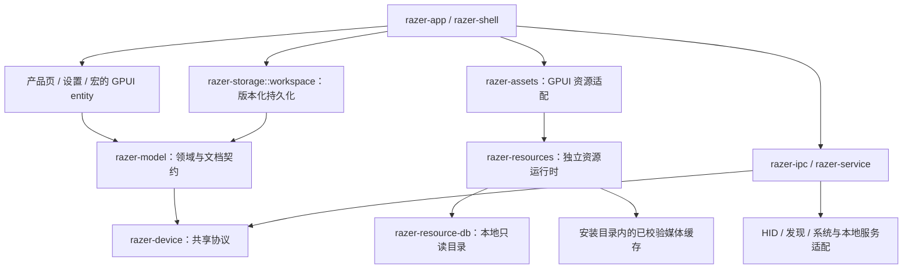

# 架构与证据身份

本项目按完整工作区管理代码、生成工具、资源和安装生命周期。功能依据逆向取得并核验的当前 Razer 原始 JS／CSS、资源及本地二进制调用链；架构参考不提供 Razer 协议或界面行为依据。目录调整、编译通过和数据等价不代表全部原版功能已经实现。

## 职责和依赖方向

| 所有者 | 责任与边界 |
| --- | --- |
| 根程序、`razer-app` | 进程入口、应用初始化和各功能组合；入口不复制页面、协议或资源实现 |
| `razer-shell` | 窗口、导航和 UI／后台动作接线；按页面及连接保留任务、订阅、焦点和清理所有权 |
| `razer-pages`、`razer-app-pages` | 设备页和应用页的交互、状态与来源呈现；render 只读取状态、组合界面 |
| `razer-dashboard`、`razer-settings`、`razer-tray` | 各自入口、交互状态及操作事件，由上层组合所需服务 |
| `razer-widgets`、`razer-i18n` | 共享展示与翻译；控件语义和产品呈现分别遵循 GPUI Kit 与原版证据 |
| `razer-model`、`razer-catalog` | 无 GPUI 的领域类型、宏文档／编译、快捷键／映射校验、偏好与模块服务快照及静态目录；区分本地草稿、模拟应答、真实设备状态 |
| `razer-state` | 应用内 GPUI 状态所有者；复用领域契约，不另建持久化类型 |
| `razer-storage` | 用户配置、实际厂商文件边界、版本迁移、扩展字段、冲突检测和原子持久化；文件保存不能冒充设备写入 |
| `razer-resource-db` | 独立只读 SQLite 的安装定位、完整性校验和有类型读取机制，不依赖页面或 GPUI |
| `razer-assets` | GPUI `AssetSource`、窗口图片／解码缓存、完成通知与资源作用域，以及唯一原生图标字节入口 |
| `razer-resources` | 无 GPUI 的资源目录、别名与身份校验、按需队列、凭据、HTTP、安装缓存、重试及工作线程关闭 |
| `razer-ipc`、`razer-agent`、`razer-service` | 本地请求／响应、后台工作、操作观察和进程生命周期；保留错误、取消、超时和释放 |
| `razer-device` | 与操作系统无关的协议、能力、配对、映射、初始化和恢复规则；依据当前 Razer 调用链 |
| `razer-hid`、`razer-discovery`、`razer-platform` | HID、发现、COM、驱动、本地服务及系统集成的平台边界；缺少能力不得伪造成功 |
| `razer-asset-pack` | 独立容器核心及格式测试；应用、安装和启动不依赖整套 pack |

依赖朝稳定的下层流动，组合层通过领域类型、命令、事件和访问器连接功能。协议和存储核心不得反向依赖 GPUI／页面；跨 crate 共享实现必须通过公开接口，禁止 `include!` 另一 crate 的私有源码。

下图展示主要组合和依赖边界；设备命令经过本地 IPC／服务及平台适配完成，不能从页面或文件保存推断写回结果。

crate 内按能力归组，例如 `keyboard/`、`mouse/`、`receiver/`、`transport/`；页面在产品族内继续按映射、DPI、校准、灯光、混音等功能组织。相关状态、命令、取消、清理及测试与功能同属一个所有者。不设全局 `data/`、`views/`、`models/` 杂物目录；小而集中的 crate 保持简单，只有独立状态、生命周期或稳定共享边界才拆分 crate。

`python tools/workspace.py organize-sources` 规划全部工作区源码，检查模块／嵌入引用和迁移幂等性，记录所有 Cargo 包、平台／构建／测试依赖、源码规模及资源输入。`--apply` 执行核验后的移动，保持已有模块接口。夹具归所属 crate 的 `testdata/`；构建不得读取分析或临时目录。调整后重新执行全目标静态检查和适用的纯／模拟测试。

工作区文档由 `razer-storage::workspace` 读写，持久化结构只依赖领域契约。`razer-shell::store` 保留公开重导出，不拥有另一份实现。宏页面保留编辑 entity、任务与事件，宏文件、导入和编译由 `razer-model::macro_library` 提供；快捷键页面同样复用 `razer-model::shortcuts` 的记录与校验。静态目录的数据库身份独立于 Rust 模块路径，移动代码所有者不能改变已安装目录键。

## 状态和生命周期

应用只读取一次 workspace 文件，将同一已校验快照用于语言选择与 shell 恢复。恢复设备时先建立页面所有者和订阅，再同步跨设备列表。实际打开“所有产品”时才创建并保留目录 entity，后续保留过滤条件、选择与滚动状态；语言变更更新已创建页面。

六族 `SourceCatalog` 按产品 ID 选择 SQLite 中的目录根，仅在请求该产品时构造完整领域对象，并由所属 `OnceLock` 保留稳定引用。保留原数据重复 ID 的首条选择语义，未知 ID 不解析其他产品。解析与分配减少不等于已测量应用启动时间或运行内存。

页面或连接拥有其观察、任务和在途请求。切换连接时取消旧任务并拒绝旧代次结果；本地服务停止须沿当前证据完成恢复、释放和清理，不能以直接退出代替。UI 的乐观更新、失败、确认、getter 回写规则逐项遵循原始调用链，额外诊断不写入原版 UI 状态。

产品保存统一经过 `shell::persistence`：`workspace_file` 组合设备快照及快捷键、偏好、自定义颜色、主界面标签顺序、Dashboard、模块服务和宏。各产品只提供本次设备候选和对应的 `ProductSave` 后续动作，不能各自拼装共同字段。单个保存请求只携带一个产品后续动作，文件写入、服务请求和设备确认仍按各自结果处理。

保存请求入队时捕获稳定设备身份与原页面的弱 entity，排队期间不重新绑定页面。完成时确认原 entity 仍存活、仍属于当前设备集合且身份一致，再确认对应版本；不能按设备列表位置配对，也不能把迟到结果交给具有相同产品名的新页面。保存失败保留原产品的失败、取消和恢复语义。

本地 named pipe、loopback 和 socket 属于本地通信。兼容性使用已核实的契约与协议版本，不使用开发路径或分析证据 SHA 作为设备可用条件。本地 DLL 替换、固件文件传输及其取消／释放／写回仍在范围内；账户、云同步、在线目录和远程更新不因架构调整进入产品。

## 固定数据与资源

| 数据类别 | 生产形式与维护入口 |
| --- | --- |
| 能力、协议参数、配对、初始化、恢复默认值 | 所属能力模块的有类型 Rust 常量、静态表或普通构造函数；默认值需要原版证据 |
| 表情、界面目录、图片选择与几何元数据 | 独立 SQLite 中的规范化表和有版本的类型化目录；普通函数读到领域对象，保留顺序、重复项、可选字段及产品分支 |
| 资源 alias、图片选择条件 | `tools/resource-mappings.json` 是维护清单，`tools/asset-release.json` 单独固定仓库、提交、长度及 SHA；统一生成 SQLite，产品不读这两份 JSON |
| 图片、视频、字体 | 当前界面实际请求单个文件，校验后缓存到安装目录，命中缓存不联网；编译或启动不全量获取 |
| 必需的 9 个 RGBA 图标与 4 个窗口控制 SVG | `razer-assets::NativeIcon` 和窗口图标入口分别提供唯一字节，托盘、菜单及窗口控制离线可用 |
| 用户配置 | 内存领域对象与磁盘格式分开，仅在实际文件／通信边界序列化；保留迁移、扩展字段、冲突及失败语义 |

静态目录使用普通有类型函数读取，协议固定表使用普通构造函数。禁止数据读取宏、巨量字面量分区、失效读取路径、空注册模块和重复生产副本。维护输入是生成来源，不是运行依赖；从旧构造器恢复的维护投影不得冒称新取得的厂商原件。生成器验证完整字段、类型、产品分支和转换等价性，结果统一记录在现有分析工作流。

`crates/razer-resource-db/installation.json` 是目录库来源、安装文件名及缓存相对目录的统一配置。Cargo 只生成小型常量并复制独立数据库到输出目录；SQLite 引擎静态链接不等于数据库内嵌到 EXE。安装器交付同一独立文件，运行时校验版本与内容，在 `assets/cache/catalogs/` 原子发布只读副本。已有有效缓存可离线使用；缺失或损坏时从 EXE 旁安装文件恢复，两者都无效则明确失败。

应用显式构造并注入一个 `ResourceRuntime`，由当前 GPUI 应用持有；`SynapseAssets` 和页面只借用它的 `ResourceClient`。资源核心独立于 GUI，不使用进程级可变资源服务，也不通过 GPUI 默认 HTTP 客户端或另一套驱动转发网络请求。工作线程拥有 Tokio 与实际 HTTP 客户端；应用退出时先关闭入队、取消在途下载并等待线程退出，旧 client 不能延长或重新打开该会话。

所有实际打开界面和共享依赖的资源按请求合批，后台在 8 ms 内收集至多 64 个文件，通过复用的 HTTP 客户端最多并行加载 4 个文件。HTTP／TLS 初始化、凭据查找、缓存读取、长度／内容校验和原子发布均在资源工作线程执行；界面只查询内存状态、排队并处理完成通知。资源任务同文件去重，状态锁内不执行文件或网络 I/O。缓存命中不初始化网络／凭据，也不重新发布同一文件；失败与重试保留实际原因，不伪装为空图、下载成功或设备已连接。升级保留有效目录与媒体缓存，卸载清理限定本安装缓存并保留用户配置。详见 [资源交付](../asset-pack-format.md) 和 [安装生命周期](../windows-installation.md)。

## 源码与验证

原始获取、完整静态恢复、逆向语义、Rust 实现、UI／后台接线、纯／模拟测试及真实验收分别记录。迁移等价只证明转换保留其输入行为；未核实的原版版本、缺失 source map、间接调用及 ABI 仍按 [统一缺项](../../.analysis/results/gaps.json) 继续处理，不能标成全部功能完成。

证据 SHA-256 从原始字节计算，以项目相对路径记录在输入索引和分析收据。Git 换行转换、重压缩及版本变化都会改变字节；不能归一化后宣称原始身份相同，也不能将证据哈希用作运行兼容性门槛。协议自身定义的校验和、哈希及版本仍须保留。

允许静态分析、格式化、全目标 `cargo check --locked`、纯 Rust 和模拟 transport 测试。禁止运行应用、厂商 JS、DLL／导出、helper、安装器或真实服务／设备；不得声称窗口、安装或真实设备运行验收通过。
